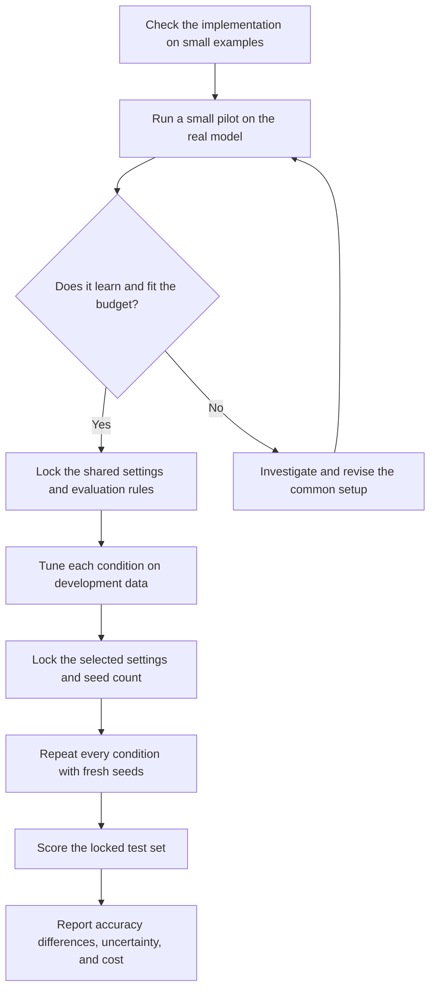

# Test plan, explained step by step

This is a plain-language companion to [TEST_PLAN.md](TEST_PLAN.md). It explains what we want to learn, why each comparison is needed, and what we would actually do. The detailed test plan remains the source for exact settings and implementation requirements.

**This describes planned work. It does not report completed experiments.** All accuracy examples below are made up, and the time allowances still need to be checked on the GPU.

The starting setup is **Qwen2.5-1.5B base, GSM8K math problems, and one H100 80 GB GPU**, with **100–200 total GPU-hours** for the whole study.

If you mainly want to understand the question, read Sections 1–5. For the practical workflow, read Sections 6–10. Sections 11–14 explain the diagnostics, budget, and final report. [BACKGROUND.md](BACKGROUND.md) gives the fuller explanation of LoRA, SVD, and DoRA.

Quick links: [experiment grid](#3-what-are-the-eight-conditions) · [same starting model](#4-how-can-different-adapters-start-as-the-same-model) · [tuning](#8-how-will-we-choose-learning-rates-and-scales) · [repeated runs](#9-why-repeat-every-selected-condition-with-fresh-seeds) · [reading the result](#10-how-do-we-score-and-interpret-the-result) · [budget](#12-how-does-this-fit-into-100-gpu-hours).

## 1. What are we trying to find out?

We want to know whether **DoRA changes how much spectral initialization helps**.

There are two choices to understand first:

- **Initialization:** how we choose the adapter's trainable matrices before training starts. Spectral initialization uses directions found in the pretrained weights. Our random comparison uses random directions with matched starting strengths.
- **Adaptation rule:** how the adapter's matrices become the weights used by the model. Additive adaptation adds a matrix adjustment. DoRA also separates each weight row's length from its direction.

Imagine that spectral initialization improves additive adaptation by 4 accuracy points. If it improves DoRA by only 1 point, spectral initialization still helps DoRA, but DoRA has reduced its benefit by 3 points. That change in benefit is our main question.

The secondary question concerns **detachment**. DoRA divides by a vector length. We can either let backpropagation differentiate through that length calculation or treat its current value as a constant while calculating gradients. Does this choice change the spectral benefit?

We also ask a practical question: how do these methods compare with ordinary LoRA and DoRA, and what do any gains cost?

**Why study this?** Spectral initialization and weight decomposition have already been combined in prior work. Our proposed contribution is a carefully controlled comparison after separate tuning, rather than introducing the first combination. See the [literature audit](references/LITERATURE_REVIEW.md) for the evidence behind that scope.

## 2. The experiment at a glance

The main workflow is:



The pilot is a rehearsal: it checks that the model can learn and that the complete study is affordable. The search chooses settings. Confirmation repeats the chosen settings with new training randomness. The official test set is reserved for the final comparison.

The order matters. If we change the parser or choose settings after seeing test scores, the test set starts influencing the experiment it is supposed to evaluate.

## 3. What are the eight conditions?

A **condition** is one recipe we will train and evaluate. The six controlled conditions form this grid:

| Training rule | Spectral start: S | Matched random start: R |
| --- | --- | --- |
| Additive adaptation: A | **A-S** | **A-R** |
| Detached DoRA: D | **D-S** | **D-R** |
| Exact-gradient DoRA: E | **E-S** | **E-R** |

Read a label in two parts. For example, **D-S** means detached DoRA with spectral initialization.

The four cells A-S, A-R, D-S, and D-R answer the primary question. E-S and E-R add the secondary comparison about detachment.

We also include two practical references:

| Label | Recipe | Why include it? |
| --- | --- | --- |
| **L0** | Ordinary additive LoRA: random A, zero B | Shows how the controlled recipes compare with a standard starting recipe |
| **D0** | Ordinary detached DoRA: random A, zero B | Gives the corresponding standard DoRA reference |

**A-R and L0 are different recipes.** In A-R, both factors start nonzero and their singular values are matched to the spectral factors. In L0, one factor starts at zero, so its initial product is zero. The same distinction applies to D-R and D0.

The six controlled conditions answer the carefully matched comparison. L0 and D0 tell us whether that comparison is useful relative to ordinary methods. L0 and D0 are outside the main interaction formulas.

## 4. How can different adapters start as the same model?

### 4.1 A small adapter changes a large weight matrix

For one layer, call the original pretrained weight matrix **W₀**. Instead of training every entry in W₀, we train two smaller matrices, **A** and **B**. Their product, **BA**, supplies the trainable part.

The adapter rank is the size of the small intermediate space. We start with rank 16. A and B stay trainable; their starting directions can change during training.

### 4.2 Spectral and random starts have matching strengths

SVD breaks a weight matrix into paired input/output directions and their strengths, called **singular values**.

The spectral start uses the top 16 direction pairs from W₀: those with the largest singular values. These describe the pretrained matrix; they are not guaranteed to be the most useful directions for GSM8K.

The random start chooses random perpendicular unit directions and gives them the same singular values. The factor strengths are also matched, with the strength split evenly between A and B.

An analogy is choosing where a set of arrows points while keeping the same list of arrow lengths. The actual construction matches singular values of matrices, rather than just individual entries or one total norm.

This avoids comparing a large spectral start with a small random start and attributing the entire difference to direction. Both starts still require SVD because the random control uses the pretrained singular values.

### 4.3 Cancel the initial adapter product

If we simply added a nonzero BA to W₀, we would change the model before training. We instead save a frozen copy of the initial product:

$$
C_0 = B_0 A_0.
$$

The weight before any DoRA normalization is:

$$
Z_t = W_0 + (B_t A_t - C_0).
$$

Here, 0 means initialization and t means the current training step. At the beginning, BA equals C₀, so the adjustment cancels:

```text
At initialization:  original weight + initial product - saved initial product
                  = original weight

During training:    original weight + current product - saved initial product
                  = original weight + the learned change
```

**C₀ stays fixed.** Replacing it with the current BA at every step would cancel the learned adjustment too.

An equivalent view is to freeze a residual, W₀ − C₀, and add the current BA to it. The implementation must preserve this cancellation accurately, including when using lower-precision model computation.

### 4.4 A small numerical example

Use a toy 2 × 2 weight and rank 1:

$$
W_0 = \begin{bmatrix}4 & 0\\0 & 1\end{bmatrix}.
$$

The following products point in different directions but both have one nonzero singular value of 4:

| Piece | Spectral direction | Alternative direction at 45 degrees |
| --- | --- | --- |
| Initial product C₀ | $\begin{bmatrix}4&0\\0&0\end{bmatrix}$ | $\begin{bmatrix}2&2\\2&2\end{bmatrix}$ |
| Frozen residual W₀ − C₀ | $\begin{bmatrix}0&0\\0&1\end{bmatrix}$ | $\begin{bmatrix}2&-2\\-2&-1\end{bmatrix}$ |
| Residual + initial product | $\begin{bmatrix}4&0\\0&1\end{bmatrix}$ | $\begin{bmatrix}4&0\\0&1\end{bmatrix}$ |

For the spectral case, the factors can be B = (2, 0)ᵀ and A = (2, 0). For the alternative, they can be B = (√2, √2)ᵀ and A = (√2, √2). Each factor has singular value 2, so the factors as well as the products match in strength.

The 45-degree direction is an illustration. Actual random controls draw directions randomly.

Both columns reconstruct the same original weight. They can nevertheless learn differently because gradients reach A and B through different factor values.

### 4.5 What does initialization scale change?

The symbol **γ**, pronounced gamma, controls the starting strength of the factors and their product. If a retained singular value is 4:

| γ | Initial product singular value: γ × 4 | Singular value of each balanced factor: √(γ × 4) |
| --- | ---: | ---: |
| 0.1 | 0.4 | About 0.632 |
| 0.3 | 1.2 | About 1.095 |
| 1.0 | 4.0 | 2.0 |

At each scale, we subtract that initialization's own C₀. **A larger γ does not mean a larger initial change to the model's predictions.** The initial net change is still zero; the trainable factors and their learning behavior change.

Keep these four quantities separate:

| Quantity | Plain-language meaning | Treatment in this study |
| --- | --- | --- |
| Learning rate, η | Controls the optimizer's step size | Tune separately for every condition |
| Initialization scale, γ | Controls the starting factor/product strengths | Tune for the six controlled conditions |
| Adapter multiplier, α/r | Multiplies the adapter contribution | Fix at 1 |
| DoRA magnitude, m | Sets the effective length of each weight row | Learn during DoRA training |

At a shared γ, S and R have matched initial spectra. Their separately selected winning γ values may differ. The main result therefore measures performance under the specified tuning search; an equal-scale comparison is a separate question.

There is another limit to the control: each start subtracts a different C₀. That also changes the set of effective weights it can reach through its low-rank product. We are comparing whole **factor-plus-residual constructions**, not isolating direction alone. The [background guide](BACKGROUND.md#4-our-control-change-directions-while-matching-singular-values) explains this more fully.

## 5. What changes when we use DoRA?

### 5.1 Learn a row's length and direction separately

Additive adaptation uses Z directly as the effective weight. DoRA normalizes each output row of Z and multiplies it by a learned length m:

$$
\text{effective row} = m \times \frac{z}{\|z\|_2}.
$$

The norm, ‖z‖₂, is the length of that row. Dividing by it gives a unit direction.

For a row z = (3, 4), the length is 5:

```text
Underlying row:      (3, 4)
Unit direction:      (0.6, 0.8)

If learned m = 5:    effective row = (3, 4)
If learned m = 6:    effective row = (3.6, 4.8)
```

We initialize m to the original row's length. Since Z initially equals W₀, DoRA also starts with the original weights and predictions.

Normalize each **output row**, across its input coordinates. With the stored PyTorch weight shape used in the plan, this is `weight.norm(dim=1)`. Choosing the wrong axis would implement a different method.

### 5.2 Exact and detached DoRA use the same forward calculation

Both variants recalculate the current row length every time the model runs forward. The difference is in the gradient calculation:

| Variant | What backpropagation does with the denominator |
| --- | --- |
| Exact-gradient DoRA: E | Includes how the row length changes when z changes |
| Detached DoRA: D | Treats the current row length as a constant for this backward pass |

Detachment does not freeze the denominator across training steps. It also does not freeze m. At identical parameter values, E and D produce the same predictions; their training updates can differ.

For intuition, changing only the length of z leaves its normalized direction unchanged. The exact gradient removes the part parallel to z. The detached gradient can retain that part. Because we update factors A and B through an optimizer, we must check what these gradient differences become in the **effective weights**.

“Exact” describes the derivative, not a promise of higher accuracy. The experiment must determine whether either rule helps in this setting.

See [BACKGROUND.md, Section 7](BACKGROUND.md#7-exact-versus-detached-dora-same-forward-value-different-gradient) for the gradient formulas and a worked example. The implementation checks must also inspect every detachment path in the pinned library version; enabling a DoRA option alone does not establish the exact variant.

## 6. What model, task, and training recipe will we use?

### 6.1 The task is learning from worked math solutions

We start with **Qwen2.5-1.5B base** and **GSM8K**, which contains math word problems and worked solutions. Supervised fine-tuning trains the model to predict the supplied solution tokens. During evaluation, the model generates its own solution and we score its final numerical answer.

For example, a constructed training example could look like:

```text
Question: There are 3 bags with 4 apples each. How many apples are there?
Answer: There are 3 × 4 = 12 apples.
#### 12
```

The model is given the question and preceding solution tokens while learning to predict the next solution token. We calculate loss on the answer and end-of-sequence tokens. We mask out question and padding tokens from that loss.

At evaluation, the prompt ends at `Answer:`. The solution and final number are not supplied.

### 6.2 Give each data partition one job

```text
GSM8K's original training set: 7,473 examples
    ├── 6,473 training examples       → update model parameters
    ├──   500 pilot examples          → check whether the setup works
    └──   500 development examples    → choose training settings

GSM8K's official test set: 1,319 examples
    └── final comparison             → score the locked experiment
```

These are proposed counts before duplicate and length checks. The detailed plan defines a repeatable hash-based split. Save the example IDs and keep duplicate question groups together; publish any resulting count changes.

The separation between pilot and development data lets us fix basic setup problems before the main settings search. The test set stays out of those decisions.

Training removes GSM8K calculator annotations such as `<<...>>` while retaining the surrounding solution and final answer. The initial training-length limit is 1,024 tokens. Inspect long examples: increase the common limit if affordable, or consistently exclude and count overlong training examples. Do not silently cut off their final answers. Every test question remains in the evaluation denominator.

### 6.3 Shared settings keep the comparison focused

| Setting | Initial choice | What it means |
| --- | --- | --- |
| Adapter placement | Query and value projections in all 28 layers | Train adapters in the same parts of every model |
| Rank | 16 | Use the same factor size everywhere |
| Training length | Three epochs | Make three passes through the training set |
| Effective batch | 32 examples | Use up to 32 examples for each optimizer update, including a smaller final batch |
| Microbatch | 8, accumulated four times | Process the effective batch in smaller pieces to fit memory |
| Optimizer | AdamW, with weight decay 0 | Use the same update algorithm for every condition |
| Rate schedule | 3% warmup, then cosine decay | Gradually raise the rate at the start, then lower it |
| Dropout | Disabled | Avoid introducing this extra source of variation |
| Precision | BF16 backbone computation; FP32 factors, norms, correction, and optimizer state | Save memory while keeping sensitive adapter calculations more precise |
| Gradient clipping | Global norm limit 1.0 | Limit very large gradients and record how often it happens |
| Final checkpoint | End of the fixed training horizon | Compare equal training exposure |

With the proposed 6,473 training examples, there are 203 optimizer steps per epoch and 609 across three epochs. If the pilot changes the data count or training horizon, recalculate these numbers.

For DoRA, factors and magnitudes use the same selected learning rate. Other model parameters remain frozen. DoRA adds magnitude parameters, so additive versus DoRA does not have identical parameter counts; exact and detached DoRA do.

The detailed optimizer settings, loss normalization, version pinning, and hardware records are in [TEST_PLAN.md, Section 3](TEST_PLAN.md#3-model-data-and-training-defaults).

## 7. What must pass before the large search?

### 7.1 First check that the implementation does what we think

Start with small synthetic matrices on CPU, then a tiny transformer, before using the real model.

| Check | What failure would mean |
| --- | --- |
| S/R factor and product singular values match at the same γ | The control changes more than the intended starting directions |
| Every condition reconstructs the original model at initialization | We are comparing different starting predictions |
| Exact gradients match the analytic rule and finite differences | The exact implementation may be wrong |
| Detached gradients match the stopped-denominator rule | The detached implementation may be wrong |
| E/D predictions agree at identical parameters | Something besides the intended backward rule differs |
| Only intended trainable parameters change | The frozen model is being modified accidentally |
| Merge and save/reload preserve predictions | Training results cannot be evaluated or reproduced reliably |
| Masking, accumulation, and answer parsing pass small examples | Loss or reported accuracy may be incorrect |
| The model can fit a 32-example training subset | Basic learning may be broken |

One subtle check: ordinary finite differences recompute the denominator and therefore test the exact derivative. To test the detached rule, compare with its analytic gradient or with a local surrogate that holds the denominator fixed.

Lower-precision arithmetic can create small numerical differences. Measure that baseline and set a justified tolerance before looking at trained outcomes. The exact pass thresholds are in [TEST_PLAN.md, Section 6](TEST_PLAN.md#6-correctness-checks-before-spending-the-main-budget).

### 7.2 Then run a pilot with three gates

The initial device checks and pilot have a combined allowance of **up to 10 GPU-hours**.

Run the four controlled DoRA conditions for 100 steps with pilot seed blocks 0, 1, and 2, initially at γ = 1 and learning rate 0.0001. Also profile the additive conditions and ordinary references. Complete one full three-epoch run of the slowest measured condition and time generation on the pilot set.

The pilot must pass:

1. **Learning:** the small overfit check works, held-out answer loss decreases, and final-answer accuracy is usable for a comparison. Very low/high accuracy or frequent output-limit endings trigger investigation. The plan's initial flags are below 5%, above 90%, or more than 1% output-limit endings; these are diagnostic prompts, not scientific conclusions.
2. **Memory:** the hardest supported batch fits with at least 10% device-memory headroom. Measure both allocated and reserved memory.
3. **Budget:** measured training and generation costs leave enough hours for the complete search, confirmation, evaluation, and failures.

A short training run alone cannot establish affordability. Final generation, loading, checkpointing, and merging also take time.

If the setup fails, investigate it during the pilot. Possible common changes include a smaller microbatch with the same effective batch, activation checkpointing, different adapter placement, a two-epoch horizon, or the 0.5B model fallback. Any such change must apply consistently and pass the relevant gates again before the main search.

If exact-gradient training would prevent adequate primary confirmation, the plan permits deferring E-S/E-R **before the main search**. The remaining six conditions can answer the primary question and support local gradient diagnostics. They cannot answer the tuned exact-versus-detached accuracy question. Record the reduced scope and budget.

The run counts and budget examples in the rest of this guide describe the full eight-condition design. Recalculate them if that fallback is selected.

If learning and affordability cannot both be established within the pilot allocation, document the failure and revise the scope before spending the remaining budget.

## 8. How will we choose learning rates and scales?

### 8.1 Give every condition its own search

A shared learning rate may happen to suit one method better. We therefore give each condition an equal number of candidate settings and the same total epoch allocation, then select separately on development data.

For each controlled condition, try:

- **Three initialization scales:** γ ∈ {0.1, 0.3, 1.0}.
- **Four learning rates:** η ∈ {0.00002, 0.0001, 0.0005, 0.002}.
- **Twelve combinations:** three scales × four rates.

L0 and D0 have no nonzero initial product to scale. Each instead gets twelve logarithmically spaced learning rates from 0.000002 through 0.002, with its standard initialization unchanged.

This gives 8 conditions × 12 candidates = **96 candidates**, using tuning seed block 10. These ranges are provisional until the pilot freezes them. Equal search effort does not guarantee that we find each method's global best setting.

### 8.2 Screen broadly, then finish a smaller set

```text
96 candidates
    │
    ├── Train each for 1 epoch
    │   Score a shared 256-question development subset
    │
    ▼
Keep 3 candidates per condition = 24 candidates
    │
    ├── Controlled conditions: keep the best rate at EACH scale
    ├── Ordinary references: keep the top 3 rates
    │
    ├── Continue each for 2 more epochs
    │   Score all 500 development questions
    ▼
Select 1 final configuration per condition = 8 configurations
```

Keeping one candidate at each controlled scale prevents early screening from removing an entire scale. Save those scale-specific winners for later equal-scale comparisons.

Use final-answer accuracy to rank candidates. For ties, use lower answer-token loss, then lower learning rate; final selection also uses lower scale if needed. **Answer-token NLL** is a loss measuring how much probability the model gives the correct solution tokens. Lower is better, but it differs from generated final-answer accuracy.

All candidates start with the full three-epoch learning-rate schedule. A promoted candidate resumes the same model, optimizer, schedule, random state, and data position. It does not restart training with a new schedule.

The workload is:

```text
Screening:       96 × 1 epoch       =  96 epochs
Continuation:    24 × 2 more epochs =  48 epochs
Total search:                       = 144 epochs
                                    =  48 three-epoch training equivalents
```

These are not 96 complete three-epoch runs. This staged search saves time, but may discard candidates that learn slowly at the beginning. Report that limitation.

If a selected rate sits at a search boundary, check whether the range is limiting the result. Any extension needs an explicit budget and equal treatment of compared conditions before confirmation; otherwise report the boundary limitation.

## 9. Why repeat every selected condition with fresh seeds?

A **seed** controls random choices such as adapter initialization and training-example order. One favorable run could reflect favorable randomness.

After selecting settings, retrain all eight conditions with fresh seed blocks **101, 202, and 303**:

```text
Block 101:  A-S  A-R  D-S  D-R  E-S  E-R  L0  D0
Block 202:  A-S  A-R  D-S  D-R  E-S  E-R  L0  D0
Block 303:  A-S  A-R  D-S  D-R  E-S  E-R  L0  D0

8 conditions × 3 blocks = 24 complete confirmation runs
```

**Paired blocks** mean that relevant runs share the same example order. The random-controlled cells also share their random bases within a block, and L0/D0 share their random A samples. Initialization and data order use separate random-number streams so that drawing adapter values does not accidentally change the batches.

Pairing makes the differences easier to compare. It does not mean that the trained models or their updates are identical.

Do not count a tuning run as a fresh confirmation run. Keep disappointing conditions and numerical failures in the record. An infrastructure interruption can resume from a checkpoint, with both allocations counted; repeatedly retrying a divergent setting until it looks favorable would bias the result.

If funding permits, choose five confirmation blocks by adding 404 and 505. **Decide the seed count before inspecting confirmation or test results.**

Every completed block must include all conditions required for its interaction estimate. A partial block is unfinished. Fewer than three complete blocks leaves the planned confirmatory study unfinished; available estimates would be exploratory.

## 10. How do we score and interpret the result?

### 10.1 Score one generated answer per test question

Use greedy decoding: at each step, choose the most likely next token. Give each model the same prompt, no worked demonstrations, no external tools, and initially a maximum of 512 new tokens. A larger limit must be chosen from pilot evidence and applied consistently before the main comparison.

The main score is:

$$
\text{accuracy} = 100 \times
\frac{\text{correctly parsed final answers}}{1{,}319}.
$$

Read the number after the **last `####`**. Normalize accepted signs, commas, and decimal/rational forms exactly. Missing, malformed, or truncated answers count as wrong. Save every raw response and its parsing result, including failures.

For example, `#### 1,200` and a reference answer of `1200` can match. A response with no valid `####` answer is wrong under the primary rule even if an earlier sentence contains the right number. A more permissive parser may be reported separately; it cannot replace the locked primary score.

Use a verified merged copy for generation and retain the training state. Also score the untouched base model once after the protocol is locked, as context. Its formatting behavior can differ, so it is not the main adaptation comparison.

### 10.2 First calculate the spectral benefit within each rule

Here is a **hypothetical single-block example**, not a prediction or result:

| Rule | Random-start accuracy | Spectral-start accuracy | Spectral minus random |
| --- | ---: | ---: | ---: |
| Additive | 30% | 34% | **+4 points** |
| Detached DoRA | 36% | 37% | **+1 point** |
| Exact DoRA | 35% | 38% | **+3 points** |

A **percentage point** is an absolute difference between percentages. Moving from 30% to 34% is +4 percentage points.

Call the three spectral benefits ΔA, ΔD, and ΔE. The symbol Δ, pronounced delta, means a difference.

### 10.3 Primary result: does DoRA change the benefit?

The primary interaction is **J = ΔD − ΔA**:

```text
Spectral benefit with additive adaptation:    +4 points
Spectral benefit with detached DoRA:          +1 point

J = 1 - 4 = -3 points
```

Here, detached DoRA reduces the spectral benefit by 3 points. Spectral initialization still helps DoRA by 1 point, and D-S has higher absolute accuracy than A-S. Those facts can all be true together.

**The best individual condition does not establish a positive interaction.** J asks how the spectral-versus-random gap changes, rather than which model has the highest score.

For any result, report both J and the within-rule gaps:

- J > 0 means detached DoRA increases the spectral-minus-random gap.
- J < 0 means detached DoRA reduces that gap.
- ΔD < 0 means spectral initialization scores worse than its matched random control within detached DoRA.

### 10.4 Secondary result: does detachment change the benefit?

The secondary interaction is **I = ΔE − ΔD**. In the example:

```text
I = 3 - 1 = +2 points
```

Allowing exact gradients increases the spectral benefit by 2 points relative to detached DoRA in this illustration. This compares two within-rule gaps; it does not establish that exact DoRA is universally better.

The exact-DoRA versus additive interaction is ΔE − ΔA = J + I, which would be −1 point here. It is another secondary comparison.

### 10.5 Put uncertainty around those differences

Compute J and I **inside each paired seed block**, then summarize the block-level values. Report their means, individual seed values, and paired Student-t 95% intervals. Do the same for each within-rule spectral gap.

Three training repeats give limited precision. As an illustration, if J has a seed standard deviation of 1.5 points, the three-seed interval has a half-width of about 3.7 points. A mean J near zero could therefore remain quite uncertain.

The plan proposes **±2 percentage points** as the practical band. This is a project decision threshold to lock before the main search, not an observed effect or a guarantee that we can detect one. Two points correspond to about 26 of the 1,319 test questions.

The following **hypothetical intervals** show how to read it:

| 95% interval for J | Interpretation |
| --- | --- |
| +2.4 to +4.0 points | Supports a practically meaningful increase in the spectral benefit |
| −4.0 to −2.4 points | Supports a practically meaningful reduction in the spectral benefit |
| −0.8 to +1.1 points | Supports an interaction small enough to lie within the practical band |
| +0.3 to +2.7 points | Detectable positive interaction, but its practical size is uncertain |
| −3.5 to +1.0 points | Inconclusive: includes zero and also allows a meaningful negative effect |

A wide interval containing zero does not establish that the methods are equivalent. Do not enlarge the practical band just because the experiment turns out to be noisy.

The primary seed interval describes training randomness for the selected settings on this locked test set. The plan also uses a paired question bootstrap: repeatedly resample the same question IDs across conditions to examine variation across test items. Resampling thousands of times does not create more independent training runs.

J is the sole primary statistical claim. Treat detachment, mechanism, cost, and layer-level relationships as secondary or exploratory unless a suitable multiple-comparison procedure is specified. The 28 layers and 1,319 questions are not 28 or 1,319 independently trained models.

See [TEST_PLAN.md, Section 5](TEST_PLAN.md#5-elaborated-hypotheses-and-decision-rules) for the precise contrasts and [Section 9](TEST_PLAN.md#9-evaluation-and-statistical-analysis) for the analysis requirements.

## 11. What do the extra measurements explain?

Final accuracy tells us what happened. Diagnostics help us understand how training behavior might relate to it.

### 11.1 Measure the weight the model actually uses

| Measurement | Question it answers |
| --- | --- |
| Initial factor and product singular values | Did we match the promised starting strengths? |
| Effective weight minus original weight | How far has this layer moved from the pretrained model? |
| Next effective weight minus current effective weight | How large is one actual update? |
| Angle between current and original rows | How much has direction changed? |
| Parallel/perpendicular parts of a row step | Does the effective step change length, direction, or both? |
| DoRA magnitude changes | How much is the learned length contributing? |
| Loss and prediction changes on a fixed probe batch | Do weight changes affect model behavior locally? |
| Gradient norms, clipping, invalid answers, truncation | Is training or generation unstable? |

The norm of BA alone can mislead us. It starts nonzero even though the model initially has zero net change. In DoRA, subtracting B₀A₀ is also insufficient because normalization and learned magnitudes affect the final weight. Use the effective merged weight for movement measurements.

Inspect representative layers at initialization, steps 1, 10, 50, and 100, and the final checkpoint. Summarize all layers at the end. These probes use training examples, not test questions.

### 11.2 Compare two possible updates from exactly the same state

Train four short diagnostic trajectories: E-S, E-R, D-S, and D-R. They use seed 40, shared γ = 1, and shared learning rate 0.0001 for 100 steps.

At steps 0, 50, and 100:

```text
One saved model + optimizer state + common training batch
                         │
              ┌──────────┴──────────┐
              ▼                     ▼
        Copy 1: exact step    Copy 2: detached step
              │                     │
              └──────────┬──────────┘
                         ▼
          Compare effective steps and predictions
```

Do not apply either hypothetical step back to the original trajectory. This is a **counterfactual** check: what would each backward rule do from this same state?

Compare step distances, angles, and probe predictions. Also rescale candidate effective steps to the same small norm for a diagnostic comparison: does a difference remain when step sizes are equal? Flag zero-step cases.

This can help separate a local step-size difference from a directional difference. It cannot replace independently tuned full training or prove that one local gradient difference caused a final accuracy gap.

Under the fallback that defers exact-arm training, use D-S/D-R states for these comparisons and state that the coverage is restricted. The detailed diagnostic definitions are in [TEST_PLAN.md, Section 5](TEST_PLAN.md#5-elaborated-hypotheses-and-decision-rules) and [Section 10](TEST_PLAN.md#10-measurements-that-distinguish-scale-from-direction).

### 11.3 Measure learning and cost as well as final accuracy

For confirmation curves, score the same 128 development questions after epochs 1 and 2. At epoch 3, use the full 500-question development score and also report its 128-question subset. Show progress against both optimizer steps and elapsed GPU time. These curves do not choose an earlier checkpoint.

A method can learn faster but finish at similar accuracy. Another can improve accuracy while costing more to initialize or tune. Report those outcomes separately.

Measure peak allocated/reserved memory, token throughput, initialization, training, generation, merging, I/O, and retries. Warm up performance measurements and synchronize timing boundaries. Count allocated GPU time during I/O too.

Report SVD once as a cached campaign cost and separately as the cost of starting on a new model. The matched random control also needs that SVD. Published speed or memory results from other setups are not measurements of ours.

## 12. How does this fit into 100 GPU-hours?

The first goal is a complete core study. All values below are **allowances**, not measured runtime forecasts:

| Work | Allowance |
| --- | ---: |
| Device correctness, initialization, and profiling | 4 hours |
| Pilot and locking the protocol | 6 hours |
| Search for six controlled conditions | 27 hours |
| Search for ordinary LoRA and DoRA | 9 hours |
| Confirmation: eight conditions × three seeds | 18 hours |
| Development/test scoring and associated I/O | 20 hours |
| Mechanism diagnostics | 4 hours |
| Contingency | 12 hours |
| **Total cap** | **100 hours** |

The training allowance assumes 0.75 hour per full three-epoch equivalent. Search uses 48 equivalents and confirmation uses 24: **72 equivalents × 0.75 hour = 54 training hours**. The pilot must measure whether that assumption is realistic, using the slowest condition for a conservative forecast.

There are 96 search starts and 24 fresh confirmation starts. Only 24 search jobs continue to three epochs, so these are not 120 full training runs.

Generation is a substantial workload. The default scoring schedule requires **86,376 completions**, before pilot/base-model scoring and retries:

| Scoring stage | Number of completions |
| --- | ---: |
| Search screen: 96 × 256 | 24,576 |
| Promoted candidates: 24 × 500 | 12,000 |
| Confirmation intermediate curves: 24 × 2 × 128 | 6,144 |
| Confirmation development scores: 24 × 500 | 12,000 |
| Confirmation test scores: 24 × 1,319 | 31,656 |
| **Total** | **86,376** |

This is why timing only the training steps is insufficient.

Keep a running ledger of spent hours and the forecast cost of unfinished work. Before locking the protocol, the forecast must cover remaining training, scoring, diagnostics, and **at least 10 hours for failures**, all within the cap. Recheck before each job and protect the unfinished confirmation/evaluation allocation.

If a common setup change is needed to fit, make it during the pilot and recheck learning. If the frozen study later becomes slower than expected, preserve complete paired blocks and state any loss of precision. Do not spend the final hours chasing a promising preliminary condition while leaving its controls unfinished.

## 13. What should extra hours buy?

The proposed expansion toward 200 hours prioritizes stronger evidence in the same experiment:

| Funding priority | Extra work | What it adds | Additional allowance |
| --- | --- | --- | ---: |
| 1 | Increase all eight conditions from three to five confirmation seeds | More information about training variability | 25 hours |
| 2 | Confirm A-S/A-R/D-S/D-R at shared γ = 1, with separately selected rates and five seeds | An equal-initial-scale comparison and the PiSSA-construction practical comparison | 30 hours |
| 3 | Repeat the top two full-run candidates per condition on tuning seeds 20 and 30 | Evidence about how stable setting selection is | 45 hours |

These allowances include scoring and reserve. They still require a measured forecast. Choose funded extensions before confirmation/test inspection. **Funding priority is not execution order:** repeated finalist tuning must finish before selected settings are locked for confirmation.

Three comparisons answer different questions:

| Comparison | What is held equal? | What can we say? |
| --- | --- | --- |
| Core, separately tuned γ and rate | Candidate budget and training exposure | How the spectral benefit differs under our bounded tuning search |
| Shared γ = 1, separately tuned rates | Initial factor/product spectra as well as shared training settings | How the benefit differs at the same starting scale |
| Shared γ and rate in short diagnostics | Local settings and matched states within each counterfactual pair | How a backward-rule change affects an effective step locally |

Equal starting scale still does not guarantee equal later gradients or weight steps.

At γ = 1, A-S uses the PiSSA initialization construction and D-S supplies its detached-DoRA hybrid. Their confirmed comparisons with L0/D0 address the practical question using those original-scale starts. If a core winner uses γ = 0.1 instead, it cannot be relabeled as that γ = 1 comparison.

The native-initialization interaction uses spectral-minus-ordinary gaps, rather than spectral-minus-matched-random gaps. Report it separately from J. Without the extension, the relevant γ = 1 comparisons remain exploratory development evidence unless **all necessary configurations exactly coincide with the confirmed core winners**.

Finalist retuning adds 32 full tuning runs: two candidates × eight conditions × two new seeds. Selection then uses mean development accuracy over seeds 10, 20, and 30. If fixed-scale selection is also to receive repeated tuning, budget its additional runs explicitly. Repeating finalists checks stability within the screened set; it does not recover every discarded slow starter.

For a budget between 100 and 200 hours, fund complete extra seed blocks first, then complete extensions that fit. A second model or task comes after these priorities and needs its own pilot, tuning, confirmation, and scoring budget.

If extra hours arrive after confirmation, changing the selected settings requires new confirmation runs. Existing runs cannot confirm settings they never used. See [TEST_PLAN.md, Section 11](TEST_PLAN.md#11-gpu-hour-budget-and-stop-rules) for the full expansion rules.

## 14. What counts as a finished study?

A finished core study should make the comparison inspectable:

1. **A locked protocol:** model/data versions, partitions, shared settings, search candidates, seeds, practical margin, parser, and analysis rules.
2. **Correctness and pilot reports:** actual numerical checks, learning behavior, memory, and measured cost forecast.
3. **The full search record:** candidates, promotions, selected rates/scales, boundaries, and failures.
4. **All confirmation results:** every condition and seed, raw generated answers, accuracy, answer loss, and uncertainty around the gaps and interactions.
5. **Mechanism and cost figures:** effective movement, learning curves, local exact/detached steps, memory, and all allocated GPU-hours.
6. **A reproducible checkpoint package:** original model revision, factor/magnitude states, frozen correction metadata, and state needed to resume training.

Saving A and B alone is insufficient for these nonzero starts. Loading them onto an untouched base model without their correction would change the reconstructed weights. Check save/load and merge behavior before the main runs.

The plan targets implementation/pilot work before search, search through late October, confirmation from October 31 to November 13, analysis from November 14 to 27, and final packaging afterward. These are proposed 2026 work windows, not evidence that any stage is complete or that a GPU is reserved. The actual course deadline still needs confirmation.

The conclusion may be a meaningful positive interaction, a meaningful negative interaction, a practically small interaction, or an inconclusive result. Each is a valid outcome if the evidence supports it.

State the limits alongside the conclusion: one model/task/rank/placement, a bounded tuning search, and a small number of training repeats. The public benchmark does not establish absence from pretraining. Local diagnostics do not establish a universal mechanism, and unconfirmed equal-scale comparisons remain exploratory.

For the exact deliverables and timeline, see [TEST_PLAN.md, Section 12](TEST_PLAN.md#12-work-sequence-and-deliverables). For paper and source pointers, use the [reference index](references/README.md).
