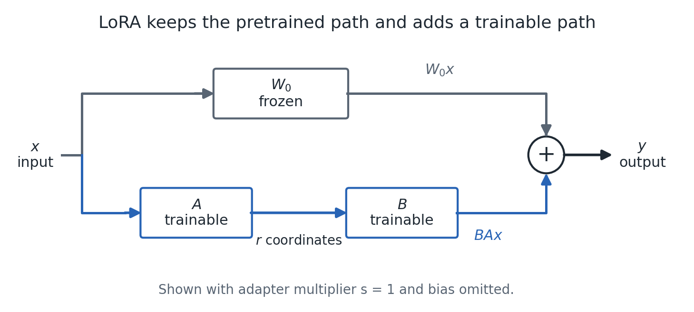
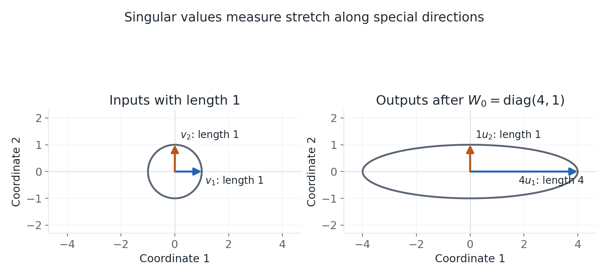
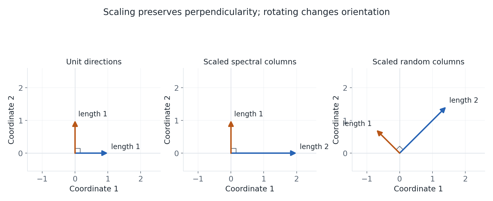
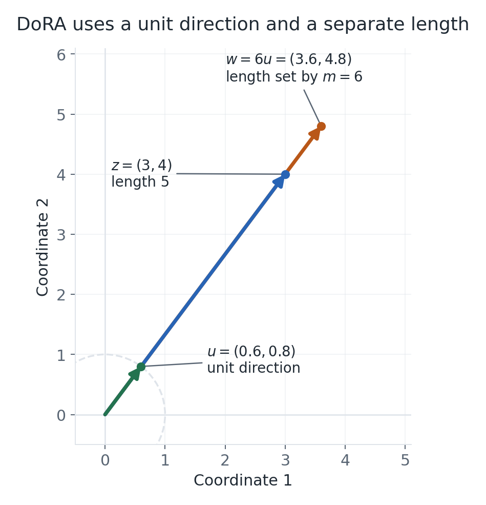
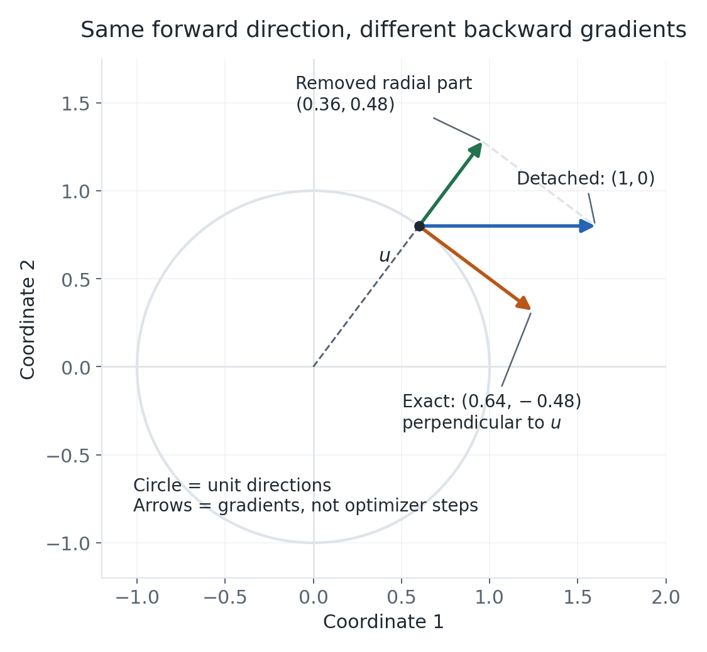
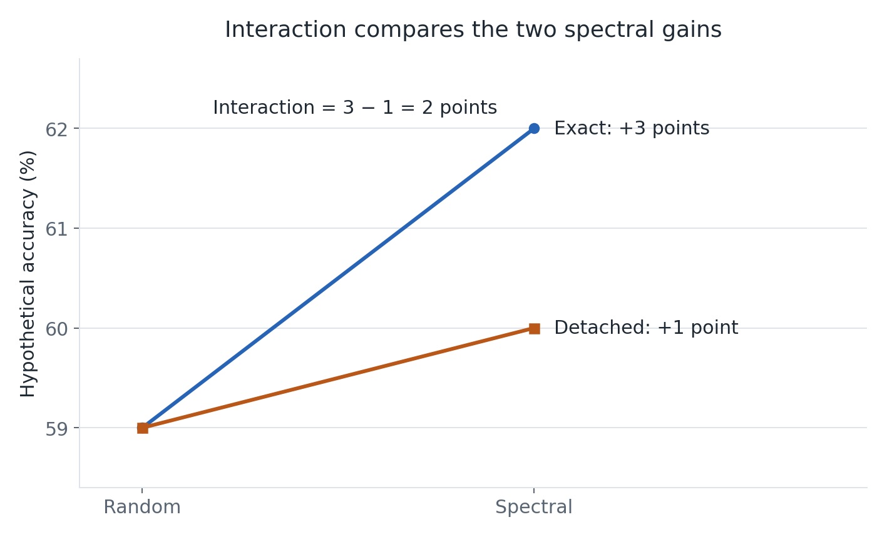

# Spectral initialization and DoRA, explained step by step

This is the slower companion to [BACKGROUND.md](BACKGROUND.md). It follows the same 11 sections, but explains the mathematical ideas before using them. Read this version first if the original guide feels too compressed; use the original afterward as a reference.

You do not need to know SVD or matrix calculus before starting. We will build from small vectors and matrices. When a derivation becomes more technical, the preceding explanation gives the idea you need to continue.

**The research question in everyday language:** we can start an adapter using directions taken from the pretrained model, or using random directions with matched strengths. We can also choose two different ways to compute gradients through DoRA's normalization. Does the usefulness of the pretrained directions depend on that gradient choice, after giving each method its own tuning budget?

**Why this could happen:** two models can make exactly the same predictions today while their trainable parameters make them take different steps tomorrow.

All numerical examples and figures in this guide are constructed teaching examples. They are not measured project results. The experimental choices come from the local [test plan](TEST_PLAN.md); they remain proposals until executed and validated. Paper IDs match the original guide. The LoRA, PiSSA, and DoRA method definitions were rechecked against their pinned paper versions on **2026-10-11**; the other literature summaries follow the original guide's existing references.

You can read one group at a time:

| Start here | What it builds |
| --- | --- |
| [Sections 1–2](#1-what-are-we-adapting) | Vectors, matrices, norms, and LoRA's bottleneck |
| [Sections 3–4](#3-svd-and-pissa-choose-the-starting-directions-from-the-weights) | SVD, orthonormal directions, factors, and residual compensation |
| [Sections 5–6](#5-why-can-identical-starting-models-learn-differently) | Gradients, factor updates, and DoRA's length/direction split |
| [Section 7](#7-exact-versus-detached-dora-same-forward-value-different-gradient) | Detachment and its possible effect on learning |
| [Sections 8–11](#8-what-the-other-reference-papers-contribute) | Related work, experimental comparisons, and evidence |

## 1. What are we adapting?

### First, what is a vector?

A vector is a list of numbers. It can represent a location, a direction, or a collection of features. For example:

$$
x=\begin{bmatrix}2\\3\end{bmatrix}.
$$

In a two-dimensional picture, this vector is an arrow from the origin to the point (2, 3). In a language model, a vector might instead contain hundreds of numbers describing a token's current representation. We can still use the arrow idea, even though we cannot draw all those dimensions.

A **scalar** is one number, such as 2 or γ. Multiplying a vector by a positive scalar changes its length while preserving its direction:

$$
2x=\begin{bmatrix}4\\6\end{bmatrix}.
$$

### A matrix combines input coordinates into outputs

A matrix is a rectangular table of numbers. Multiplying a vector by a matrix creates a new vector. Each matrix row specifies one weighted sum of the input coordinates:

$$
W=\begin{bmatrix}1&2\\-1&1\end{bmatrix},\qquad
Wx=\begin{bmatrix}1\cdot2+2\cdot3\\-1\cdot2+1\cdot3\end{bmatrix}
=\begin{bmatrix}8\\1\end{bmatrix}.
$$

So a matrix with 3 rows and 4 columns takes 4 input coordinates and produces 3 output coordinates. Its **shape** is 3 × 4. For the single-column input vectors used in this guide:

$$
\underbrace{W}_{3\times4}\,
\underbrace{x}_{4\times1}
=\underbrace{y}_{3\times1}.
$$

The adjacent dimensions must match. The remaining dimensions describe the result. A **transpose**, written Wᵀ, exchanges a matrix's rows and columns. A 3 × 4 matrix becomes 4 × 3.

One language-model layer can be written as:

$$
y=W_0x+b.
$$

W₀ is the pretrained matrix: the numbers learned before our task-specific training. The bias b adds one offset per output. The subscript 0 marks the original or initial value.

### What does fine-tuning change?

During **fine-tuning**, the model sees task examples, computes a **loss** measuring prediction error, and adjusts trainable numbers to try to reduce that loss.

Full fine-tuning trains all model weights. **Parameter-efficient fine-tuning**, or PEFT, trains a smaller collection of numbers while keeping most of the pretrained model **frozen**. Frozen means the optimizer does not change those numbers. They still participate in the computation that produces predictions, and gradients may still need to pass through their operations to reach trainable adapters elsewhere.

Think of keeping an existing calculation and attaching a small adjustable correction to it. The existing calculation still runs.

### Length and norms

The length of a vector is its Euclidean norm. In two dimensions, it follows the Pythagorean theorem:

$$
\left\|\begin{bmatrix}3\\4\end{bmatrix}\right\|_2
=\sqrt{3^2+4^2}=5.
$$

The **Frobenius norm** of a matrix similarly squares every entry, adds them, and takes the square root:

$$
\left\|\begin{bmatrix}3&0\\0&4\end{bmatrix}\right\|_F=5.
$$

Both are measures of size, but one concerns a vector and the other a matrix. Equal norm values do not mean two objects perform the same computation.

**What to carry forward:** matrix shape tells us which vectors a transformation accepts and produces. Frozen weights still run. A norm measures size, and a scalar can scale a vector or matrix without becoming that object.

## 2. LoRA: learn an adjustment through a small bottleneck

### Why replace one large adjustment with two smaller matrices?

Suppose a pretrained layer uses a large matrix W₀. We could learn an equally large correction, but that would introduce many trainable numbers. **LoRA**, short for Low-Rank Adaptation, instead represents the correction as the product of two smaller matrices:

$$
W_{eff}=W_0+sBA.
$$

W_eff is the weight actually used to make the prediction. The scalar s is an adapter multiplier; it is commonly written α/r. Our proposed experiment uses s = 1, so the examples below omit that multiplier. W₀ stays frozen; A and B are trained. [LoRA, R7, §4.1](https://arxiv.org/html/2106.09685v2#S4.SS1)

The computation has two paths:

$$
y=W_0x+B(Ax)+b.
$$

The diagram shows why the pretrained computation is still needed. It also shows the order: A acts first, even though the written product is BA.

For a layer with 4 inputs, 6 outputs, and r = 2:

| Object | Shape | Job |
| --- | --- | --- |
| x | 4 × 1 | Input vector |
| A | 2 × 4 | Form two intermediate coordinates |
| Ax | 2 × 1 | Small intermediate vector |
| B | 6 × 2 | Turn those coordinates into six outputs |
| BA | 6 × 4 | Complete adapter correction |

### What does rank mean?

The **rank** of a matrix is the number of independent output directions it can produce. “Independent” means one direction cannot be assembled as a combination of the others.

For rank 1, A produces just one scalar h. B has one column, which is an output vector b₁:

$$
h=Ax,\qquad B(Ax)=h\,b_1.
$$

Different inputs change h, but the adapter output always lies along the same line at that moment. It can move forward or backward along b₁, or produce zero. With rank 2, it can combine two columns of B. The set of their possible combinations is a **subspace**.

Because B is trained, those directions can change during learning. The rank limit constrains how many directions the current adapter uses; it does not lock them permanently to their initial orientation. The product's rank is **at most** r and may be smaller.

### Where do the savings come from?

For a 1024 × 1024 weight and r = 8, the trainable factor count is:

$$
\underbrace{8\cdot1024}_{A}
+\underbrace{1024\cdot8}_{B}
=16{,}384.
$$

The full weight has 1,048,576 entries, 64 times as many. This is a parameter-count comparison for this matrix. Training time also depends on running the backbone, computing derivatives, memory use, and the optimizer; it is not automatically reduced by the same factor.

### Why initialize only one factor to zero?

Standard LoRA starts with random A and zero B. Then BA = 0, preserving the pretrained weight initially. Nevertheless, the gradient of B can be nonzero because it depends on A. The gradient of A starts at zero because it depends on B. After B changes, A can receive a loss gradient too. Section 5 will explain the equations.

If both factors start at zero, both task-loss gradients are zero: neither factor can start moving under those gradients. The original LoRA paper uses Gaussian A; our baseline proposes Kaiming-uniform A, another random initialization scheme. The crucial feature here is random A with zero B. [LoRA, R7, §4.1](https://arxiv.org/html/2106.09685v2#S4.SS1)

**What to carry forward:** LoRA adds a trainable correction through a narrow intermediate vector. It reduces trainable parameter count while retaining the original model computation.

## 3. SVD and PiSSA: choose the starting directions from the weights

### Perpendicular, unit length, and orthonormal

Two vectors are **orthogonal** if they are perpendicular. A vector is **normalized** if its length is 1. A set of vectors is **orthonormal** when every vector has length 1 and distinct vectors are perpendicular.

The dot product multiplies matching entries and adds them:

$$
\begin{bmatrix}a\\b\end{bmatrix}^{T}
\begin{bmatrix}c\\d\end{bmatrix}=ac+bd.
$$

For perpendicular vectors it is zero. For a unit vector dotted with itself it is 1. Therefore, for an orthonormal set:

$$
v_i^Tv_j=
\begin{cases}
1,&i=j,\\
0,&i\ne j.
\end{cases}
$$

The horizontal vector (1, 0) and vertical vector (0, 1) are a familiar orthonormal pair. Rotating both by the same angle gives another orthonormal pair.

### A basis gives coordinates along directions

A **basis** is a collection of independent directions that can build every vector in the space. In a complete orthonormal basis, the dot product with one basis vector gives the amount of the input along that direction:

$$
x=\sum_i(v_i^Tx)v_i.
$$

Why? If x = c₁v₁ + c₂v₂, taking the dot product with v₁ makes the v₂ term disappear and leaves c₁. Unit length ensures we do not introduce an extra scale factor.

With the usual horizontal and vertical basis, (3, 2) simply has coefficients 3 and 2. With a rotated basis, the vector is unchanged but its coordinates are different. Keeping only some basis vectors gives the **projection** onto their span, rather than reconstructing every vector exactly.

### SVD finds useful coordinates for describing a matrix

**Singular value decomposition**, or SVD, expresses a matrix as:

$$
W_0=U\Sigma V^T.
$$

The names describe three parts of the same transformation:

| Part | Meaning |
| --- | --- |
| Columns of V, called vᵢ | Special unit input directions |
| Diagonal entries of Σ, called σᵢ | Nonnegative stretch amounts, or singular values |
| Columns of U, called uᵢ | Corresponding unit output directions |

The transpose Vᵀ computes dot products with the input directions. Σ scales those coordinates. U assembles them along the output directions. The input and output directions can involve rotations or reflections; for rectangular matrices, the input and output spaces can also have different dimensions.

The defining relation is:

$$
W_0v_i=\sigma_i u_i.
$$

If σᵢ = 4, a unit input along vᵢ produces an output of length 4 along uᵢ. An input 2vᵢ produces 8uᵢ by linearity. A zero singular value means that input direction is sent to zero.

This diagonal example needs no rotation: the special directions are already the coordinate axes. More general matrices use other input and output bases.

### Why can SVD choose perpendicular output directions?

Perpendicular inputs do not necessarily remain perpendicular under an arbitrary matrix. SVD chooses input directions that make this happen.

Form W₀ᵀW₀, a square symmetric matrix. An **eigenvector** of a matrix is a direction the matrix maps back onto the same line; its **eigenvalue** is the scaling along that direction. Choose unit eigenvectors vᵢ of W₀ᵀW₀:

$$
W_0^TW_0v_i=\lambda_i v_i.
$$

This symmetric matrix has an orthonormal eigenbasis, and its eigenvalues are nonnegative. The reason they cannot be negative is that:

$$
v^TW_0^TW_0v=\|W_0v\|_2^2\geq0.
$$

For distinct chosen basis vectors, the output dot product is:

$$
(W_0v_i)^T(W_0v_j)
=v_i^TW_0^TW_0v_j
=\lambda_jv_i^Tv_j
=0.
$$

For one unit basis vector, the same calculation gives output length squared λᵢ. So define:

$$
\sigma_i=\sqrt{\lambda_i},\qquad
u_i=\frac{W_0v_i}{\sigma_i}\quad\text{when }\sigma_i>0.
$$

The nonzero outputs become perpendicular unit vectors after dividing by their lengths. Zero-output directions contribute nothing to the transformation; orthonormal vectors can complete the full output basis.

Finally, applying W₀ to the basis expansion of any input gives:

$$
W_0x
=\sum_i(v_i^Tx)W_0v_i
=\sum_{\sigma_i>0}\sigma_i u_i(v_i^Tx).
$$

That is exactly what UΣVᵀ does. This eigenvector construction explains existence; practical numerical libraries usually use more stable direct SVD algorithms rather than explicitly forming W₀ᵀW₀.

### Keeping only the strongest components

An **outer product** uᵢvᵢᵀ is a matrix that takes the input's coefficient along vᵢ and sends it along uᵢ. This lets us write SVD as a sum of simple components:

$$
W_0=\sum_i\sigma_i u_i v_i^T.
$$

Sort singular values from largest to smallest. Keeping the first r terms gives the best approximation with rank at most r in Frobenius norm. It describes the largest contributions to the pretrained matrix's reconstruction. It does **not** prove that these directions are the most useful for a new task.

For W₀ = diag(4, 1), keeping only the top component gives diag(4, 0). The missing component is diag(0, 1).

### PiSSA makes the large component trainable

PiSSA starts its trainable factors from these principal singular components, and puts the remaining part in a frozen **residual**, meaning what is left after subtraction:

$$
B_0=U_r\Sigma_r^{1/2},\qquad
A_0=\Sigma_r^{1/2}V_r^T,\qquad
W_{res}=W_0-B_0A_0.
$$

The subscript r means we retain r singular components. Σᵣ¹ᐟ² is a diagonal matrix formed by taking the square root of each retained singular value. For rank 1 in our diagonal example:

$$
B_0=\begin{bmatrix}2\\0\end{bmatrix},\qquad
A_0=\begin{bmatrix}2&0\end{bmatrix},\qquad
B_0A_0=\begin{bmatrix}4&0\\0&0\end{bmatrix}.
$$

Each factor carries strength 2, whose product is 4. The residual supplies the missing bottom-right 1:

$$
\underbrace{\begin{bmatrix}0&0\\0&1\end{bmatrix}}_{W_{res}}
+\underbrace{\begin{bmatrix}4&0\\0&0\end{bmatrix}}_{B_0A_0}
=W_0.
$$

The initial model is preserved even though both factors are nonzero. Training changes A and B while keeping the residual fixed. [PiSSA, R2, §3](https://arxiv.org/html/2404.02948v4#S3)

**What to carry forward:** SVD separates directions from their stretch amounts. PiSSA uses the strongest pretrained components to start the trainable adapter, with a compensating frozen residual.

## 4. Our control: change directions while matching singular values

### Why a random comparison needs careful construction

If a spectral adapter beats a random adapter, several explanations are possible. It might have better directions. It might simply have larger factors, which affect learning steps. To study orientation, our control keeps the prescribed initial strengths while replacing the directions.

Let Q_L and Q_R be random matrices whose columns form orthonormal sets. They need not be square or span their entire ambient spaces: each contains r directions. We use the same retained singular values for both conditions:

$$
\begin{aligned}
B_{S,0}&=\sqrt\gamma\,U_r\Sigma_r^{1/2},&
A_{S,0}&=\sqrt\gamma\,\Sigma_r^{1/2}V_r^T,\\
B_{R,0}&=\sqrt\gamma\,Q_L\Sigma_r^{1/2},&
A_{R,0}&=\sqrt\gamma\,\Sigma_r^{1/2}Q_R^T.
\end{aligned}
$$

S means spectral and R means random. Uᵣ and Q_L are output-side directions; Vᵣ and Q_R are input-side directions. In the experiment, the two random bases are drawn independently.

### γ is one number; the factors are matrices

The scalar γ > 0 controls initialization size. The square root appears in **both** factors so their product is scaled by γ:

$$
\sqrt\gamma\cdot\sqrt\gamma=\gamma.
$$

Column i of B₀ is a unit direction multiplied by √(γσᵢ). Row i of A₀ has the same length. Thus:

$$
\text{factor singular values}=\sqrt{\gamma\sigma_i},\qquad
\text{product singular values}=\gamma\sigma_i.
$$

“The scaled factors are not generally orthonormal” refers to the **columns of B₀ and rows of A₀**, not to the scalar γ. Scaling leaves distinct directions perpendicular, but their lengths are generally no longer 1. For γ = 1 and retained singular values 4 and 1, the lengths are 2 and 1. For γ = 9, they become 6 and 3.

The rotated pair illustrates changing orientation while retaining strengths. It depicts the output-side columns only; it is not a requirement that the input-side random basis use that same rotation.

### Matching strengths does not make the matrices identical

The two conditions have the same initial factor singular values and product singular values at a shared γ. Their product Frobenius norms also match. Their entries and action on particular inputs can differ.

For example, choose rank 1, γ = 1, and W₀ = diag(4, 1):

| Quantity | Spectral direction | Illustrative direction at 45 degrees |
| --- | --- | --- |
| B₀ | (2, 0)ᵀ | (√2, √2)ᵀ |
| A₀ | (2, 0) | (√2, √2) |
| Product | [[4, 0], [0, 0]] | [[2, 2], [2, 2]] |
| Product's nonzero singular value | 4 | 4 |

The illustrative right column happens to use the same input and output direction; actual random draws need not. Both products have equal strength but clearly different entries.

### Each condition needs its own compensation

For each starting product, make a frozen copy C₀ and subtract it from the original matrix:

$$
C_0=B_0A_0,\qquad W_{res}=W_0-C_0.
$$

The spectral residual is diag(0, 1). The illustrated random residual is:

$$
\begin{bmatrix}4&0\\0&1\end{bmatrix}
-\begin{bmatrix}2&2\\2&2\end{bmatrix}
=\begin{bmatrix}2&-2\\-2&-1\end{bmatrix}.
$$

Adding its own product back gives W₀ in either case. Reusing the spectral residual with the random product would instead change the starting model.

During training, define:

$$
Z_t=W_{res}+B_tA_t=W_0+(B_tA_t-C_0).
$$

Here t denotes a training step. C₀ stays fixed. If we recalculated it from the current factors every time, we would cancel their learning and keep Z_t equal to W₀ forever.

### Product size and model movement are different

At initialization the product is nonzero, but its compensation makes the net change zero. For the additive conditions, the change from the pretrained weight is:

$$
W_{eff,t}-W_0=B_tA_t-B_0A_0.
$$

Each product has rank at most r. Their difference can have rank up to 2r, bounded also by the layer dimensions, because it can contain directions from both products. For instance, the difference between diag(1, 0) and diag(0, 1) is diag(1, −1), which has rank 2 even though each original matrix has rank 1.

Standard zero-initialized LoRA has no nonzero starting product to subtract, so its additive net change has rank at most r. Equal factor counts do not give these constructions identical sets of possible changes. This comparison concerns the additive weights; DoRA adds row normalization and magnitudes.

**What to carry forward:** the control matches initial spectra and predictions, while leaving learning behavior to be measured. It still needs the pretrained singular values, so it still incurs SVD cost.

## 5. Why can identical starting models learn differently?

### A derivative measures sensitivity

Suppose a loss depends on one trainable number θ. Its **derivative** tells us approximately how much the loss changes when θ changes a little:

$$
\Delta\mathcal L\approx\frac{d\mathcal L}{d\theta}\,\Delta\theta.
$$

A positive derivative means increasing θ raises the loss locally; decreasing θ can lower it. Plain **gradient descent** takes a step opposite the derivative:

$$
\theta_{new}=\theta-\eta\frac{d\mathcal L}{d\theta}.
$$

The positive learning rate η controls the step size. A **gradient** collects these sensitivities for every coordinate of a vector or every entry of a matrix. A **partial derivative** changes one parameter while holding the others fixed. This is a local description: a sufficiently large step need not reduce the loss.

### Gradients follow the path from parameters to predictions

The **chain rule** says that when one quantity affects another through an intermediate quantity, their sensitivities multiply along that path. Begin with scalars:

$$
Z=BA,\qquad G=\frac{d\mathcal L}{dZ}.
$$

Changing B changes Z at rate A. Changing A changes Z at rate B. Therefore:

$$
\frac{d\mathcal L}{dB}=GA,\qquad
\frac{d\mathcal L}{dA}=BG.
$$

The loss can make the same request at Z, while different A and B pass that request to their parameters differently.

For matrices, the same idea becomes:

$$
G=\frac{\partial\mathcal L}{\partial Z},\qquad
\frac{\partial\mathcal L}{\partial B}=GA^T,\qquad
\frac{\partial\mathcal L}{\partial A}=B^TG.
$$

To see one entry rather than treating this as a rule to memorize, write:

$$
Z_{ij}=(W_{res})_{ij}+\sum_k B_{ik}A_{kj}.
$$

Changing B_ik affects every output entry Z_ij in row i, with sensitivity A_kj. Sum the corresponding loss contributions over j:

$$
\frac{\partial\mathcal L}{\partial B_{ik}}
=\sum_j G_{ij}A_{kj}
=(GA^T)_{ik}.
$$

This also explains LoRA's zero initialization: if B = 0, the displayed A gradient is zero; if A is nonzero, B's gradient can still be nonzero.

### A numerical example: same output, different steps

Compare scalar factors (B, A) = (2, 2) and (4, 1). Both give Z = 4. Suppose the upstream gradient is G = 1 and η = 0.01. Evaluate both factor gradients before changing either factor:

| Quantity | B = 2, A = 2 | B = 4, A = 1 |
| --- | --- | --- |
| Starting product | 4 | 4 |
| Gradient of B | 2 | 1 |
| Gradient of A | 2 | 4 |
| Updated factors | 1.98, 1.98 | 3.99, 0.96 |
| Updated product | 3.9204 | 3.8304 |
| Product change | −0.0796 | −0.1696 |

The outputs started equal, and the loss supplied the same G. The resulting changes still differ. **Parameterization** means the choice of trainable coordinates used to describe a model, such as A and B rather than their product alone. That choice affects learning dynamics.

This scalar example isolates factor-size imbalance, not a spectral/random orientation comparison. Our proposed balanced construction avoids this particular imbalance; matrix orientation can still make the update maps differ.

### How the matrix step arises

After one simultaneous plain gradient-descent step:

$$
B'=B-\eta GA^T,\qquad A'=A-\eta B^TG.
$$

The product changes through three contributions: the change in B times the old A, the old B times the change in A, and the product of both changes. Expanding gives:

$$
\Delta Z=B'A'-BA
=-\eta\left(GA^TA+BB^TG\right)
+\eta^2GA^TB^TG.
$$

The last term contains η twice. For small steps, the **first-order approximation** keeps only terms proportional to η:

$$
\Delta Z\approx-\eta\left(BB^TG+GA^TA\right).
$$

BBᵀ weights and mixes the gradient's output directions; AᵀA weights and mixes its input directions. They are not generally identity matrices or simple orthogonal projectors. Equal singular values can give equal strengths along differently oriented directions, so these weighting matrices need not match between S and R.

The planned optimizer is **AdamW**, which keeps a history of gradients and changes the coordinate-wise scaling of updates. Its general definition also includes weight decay; this plan sets weight decay to zero. The gradient-descent formula is a teaching illustration, not its exact step. Actual clipping and optimizer behavior must be included when measuring effective changes.

### Four quantities that should not all be called “the scale”

| Symbol | Everyday interpretation | Where it acts |
| --- | --- | --- |
| η | How large an optimizer step is | Parameter update |
| s | How much the adapter contributes | Forward rule W₀ + sBA |
| γ | How large the starting factors/product are | Initialization, with frozen compensation |
| m | Desired length of a DoRA row | Effective weight after normalization |

Changing γ can preserve the starting model but alter its factor gradients. Changing η changes the optimizer step. Changing s changes the adapter's contribution and its derivative. Changing m changes the effective row length. These operations cannot generally substitute for one another.

**What to carry forward:** gradients depend on the route through the trainable factors. Equal starting predictions do not imply equal factor gradients or effective weight steps. Comparisons of upstream gradients assume the same batch and the same forward stochastic state; the plan disables dropout.

## 6. DoRA: learn length and direction separately

### A vector has both a direction and a length

The vectors (3, 4) and (6, 8) point in the same direction, but the second is twice as long. Dividing by length makes either one a unit vector:

$$
z=\begin{bmatrix}3\\4\end{bmatrix},\qquad
u=\frac{z}{\|z\|_2}=\begin{bmatrix}0.6\\0.8\end{bmatrix}.
$$

We can recover a vector of any chosen positive length m along that direction by multiplying u by m.

### DoRA makes that separation trainable

**DoRA**, short for Weight-Decomposed Low-Rank Adaptation, learns a magnitude separately from the direction coordinates. For one row in our proposed construction:

$$
z=(W_{res}+BA)_{i:},\qquad
w=m\frac{z}{\|z\|_2}=mu.
$$

The notation i: means “all input coordinates of output row i.” Here z is the underlying row before normalization, while w is the effective row used in the layer. We sometimes write that row as a column vector to simplify vector derivatives. [DoRA, R1, §4.1](https://arxiv.org/html/2402.09353v6#S4.SS1)

The adapter factors change the direction coordinates z. The trainable scalar m controls the effective row's length. For z = (3, 4):

| Magnitude m | Effective row w | Length |
| --- | --- | --- |
| 5 | (3, 4) | 5 |
| 6 | (3.6, 4.8) | 6 |
| 10 | (6, 8) | 10 |

These examples use positive m. Algebraically the effective length is |m|, and a negative m would reverse the direction. The plan initializes each m from a nonnegative pretrained norm; calling it a magnitude does not itself impose a positivity constraint during optimization.

### Preserve the pretrained starting point

Because Z₀ = W₀, choose each starting magnitude as that pretrained row's length:

$$
m_{0,i}=\|W_{0,i:}\|_2.
$$

Then, for a nonzero row:

$$
m_{0,i}\frac{W_{0,i:}}{\|W_{0,i:}\|_2}=W_{0,i:}.
$$

Normalize each output row separately over its input coordinates, rather than using one norm for the entire matrix. In our stored weight orientation this corresponds to `weight.norm(dim=1)`. Different papers may transpose the matrix, so compare the meaning of the coordinates rather than copying a dimension number blindly. The ideal formulas assume nonzero rows; the test plan specifies a shared numerical norm floor and checks for it.

### Why normalization does not erase all scale choices

Multiplying the entire z by a positive scalar leaves its unit direction unchanged. But changing only BA inside a sum is a different operation:

$$
W_{res}=(1,0),\qquad BA=(0,1),\qquad z=(1,1).
$$

Doubling the whole row gives (2, 2), the same direction. Doubling just BA with the residual held fixed gives (1, 2), a different direction.

At initialization, our residual compensation handles the changed product so the starting model is preserved. During training that residual is frozen. Moreover, derivatives depend on the underlying coordinates and their factorization. Equal normalized forward values therefore do not make γ or η irrelevant.

**What to carry forward:** DoRA uses a unit direction from the reconstructed row and a separately learned scalar for its effective length. It still learns through A and B.

## 7. Exact versus detached DoRA: same forward value, different gradient

### Forward computation and backward computation do different jobs

The **forward pass** computes the model's prediction and loss. The **backward pass**, or backpropagation, computes the loss derivatives used to update trainable parameters.

In DoRA, changing z changes both the numerator z and the denominator ‖z‖₂. Exact differentiation accounts for both dependencies. **Detachment**, also called stop-gradient, uses a quantity's numerical value in the forward pass but treats it as a constant during differentiation.

The two rules are:

$$
w_E=m\frac{z}{\|z\|_2},\qquad
w_D=m\frac{z}{\operatorname{stopgrad}(\|z\|_2)}.
$$

E means exact and D means detached. At the same parameters, they produce exactly the same forward value. The difference appears when computing derivatives. The original DoRA paper describes denominator detachment as a way to reduce training overhead. [DoRA, R1, §4.3](https://arxiv.org/html/2402.09353v6#S4.SS3)

Detachment does **not** save one denominator forever. If the row's norm is 5 on this forward pass, the backward pass treats that value as a constant. If updated parameters make the norm 7 on the next forward pass, the denominator becomes 7. The magnitude m remains trainable in both rules.

### A small derivative example before the vector formula

Hold m fixed and imagine increasing only the length of z without changing its direction. The numerator becomes larger, but so does the norm. In the exact normalized function, the two effects cancel. Its output direction does not change.

The detached backward rule ignores the denominator's response to z. It therefore computes a nonzero sensitivity even for some changes that only stretch z. It is an intentional modified gradient, not the true derivative of the whole normalized forward function.

### Separate a gradient into two components

Let g be the loss gradient with respect to the effective row w. It tells us how the loss responds if we change w directly. Define the unit direction u = z/‖z‖₂.

The dot product uᵀg tells us how much of g lies along u. Multiply that scalar by u to construct the **parallel**, or **radial**, component:

$$
g_{parallel}=u(u^Tg).
$$

Subtract it to get the perpendicular component:

$$
g_{perpendicular}=g-u(u^Tg).
$$

For an arrow pointing from the origin to a circle, the radial direction points outward along the arrow. The perpendicular direction is **tangent**: it lies along the line touching the circle at the arrow's endpoint. In higher dimensions the same idea uses a sphere and a tangent plane.

### The two gradients with respect to z

Exact differentiation removes the radial component, because a radial change in z does not change its normalized direction. Detached differentiation keeps the full g:

$$
g_E=\frac{m}{\|z\|_2}\left(g-u(u^Tg)\right),\qquad
g_D=\frac{m}{\|z\|_2}g.
$$

Both have the factor m/‖z‖₂. This already shows that equal forward directions can have different sensitivities if their underlying z lengths differ.

To see where the projection comes from, call a small row change δz. Its first-order change in length is uᵀδz. Dividing by the changing norm then gives:

$$
\delta u\approx\frac{1}{\|z\|_2}
\left(\delta z-u(u^T\delta z)\right).
$$

The second term subtracts the part that only changes length. Passing a loss gradient backward through this symmetric projection gives g_E above. Dropping the norm's derivative drops that subtraction. This is the same geometric derivative presented in the DoRA analysis, written in our row orientation. [DoRA, R1, §4.2](https://arxiv.org/html/2402.09353v6#S4.SS2)

### Work through the numbers

Use z = (3, 4)ᵀ, m = 5, and g = (1, 0)ᵀ. We get:

$$
u=\begin{bmatrix}0.6\\0.8\end{bmatrix},\qquad
u^Tg=0.6,\qquad
u(u^Tg)=\begin{bmatrix}0.36\\0.48\end{bmatrix}.
$$

Since m/‖z‖₂ = 1:

$$
g_E=\begin{bmatrix}1\\0\end{bmatrix}
-\begin{bmatrix}0.36\\0.48\end{bmatrix}
=\begin{bmatrix}0.64\\-0.48\end{bmatrix},\qquad
g_D=\begin{bmatrix}1\\0\end{bmatrix}.
$$

Check perpendicularity:

$$
z^Tg_E=3(0.64)+4(-0.48)=0.
$$

The arrows show gradients, rather than negative-gradient optimizer steps. They are anchored at the unit direction to show the geometry. The dashed connection illustrates adding the radial and tangent components to obtain the full gradient.

### Can exact DoRA still learn length?

Yes. The direction coordinates z are only one set of trainable coordinates. Both rules also give:

$$
\frac{\partial\mathcal L}{\partial m}=u^Tg.
$$

A purely radial g can give zero exact gradient for z but a nonzero gradient for m. The effective row can change length through m. Removing the radial component from the direction-coordinate gradient does not prevent magnitude learning.

### Why a radial difference can still matter through factors

If z itself were directly trained, a small radial step would not change its normalized direction to first order. But our optimizer updates A and B, which then change z. Section 5 showed that those factor updates transform the upstream gradient before producing a row change.

Here is a constructed one-row example. Temporarily hold m fixed so we can isolate the factor path:

$$
B=1,\quad A=\begin{bmatrix}1&0\end{bmatrix},\quad
W_{res}=\begin{bmatrix}0&1\end{bmatrix},\quad
z=\begin{bmatrix}1\\1\end{bmatrix},\quad
m=\sqrt2,\quad g=\begin{bmatrix}1\\1\end{bmatrix}.
$$

This g is radial. The exact z-gradient is zero; the detached z-gradient is (1, 1). Under plain gradient descent, detached factor gradients give:

$$
\delta B=-\eta,\qquad
\delta A=\begin{bmatrix}-\eta&-\eta\end{bmatrix}.
$$

Their first-order product change is:

$$
\delta Z\approx(\delta B)A+B(\delta A)
=\begin{bmatrix}-2\eta&-\eta\end{bmatrix}.
$$

This change is no longer parallel to (1, 1). Its perpendicular component is (−η/2, +η/2), which normalization can retain as a direction change. The factor path has transformed a radial upstream gradient into an update with a tangent component.

Holding m fixed is essential to this illustration. If m were trained, both variants would additionally receive the same nonzero magnitude gradient at this state. AdamW can further alter the relationship between raw gradients and resulting changes.

### What this does and does not predict

At initialization, our main conditions share Z₀, m₀, and predictions. Within either gradient rule, the spectral and random conditions receive the same upstream Z gradient on the same batch and stochastic state. Their factors can turn it into different parameter steps. Across exact and detached rules, the upstream gradient itself differs.

That makes an interaction between initialization and gradient rule plausible. It does not predict whether exact or detached will win, or whether an accuracy gap will be measurable. A mathematically exact derivative is not automatically the best-performing training procedure.

Implementation must match the claimed rule. The project's saved [PEFT source snapshot](references/metadata/peft_dora_source_snapshot.py) contains detachment; a DoRA configuration flag alone does not establish an exact variant. Inspect the actual code path and compare gradients with the formulas above. Finite differences of the shared forward function check the exact derivative; the intentionally modified detached derivative should instead be checked against its stated stop-gradient rule.

**What to carry forward:** exact and detached DoRA share the normalized forward computation but differ in backpropagation. Low-rank factors can make that difference affect direction changes, and its task impact needs an experiment.

## 8. What the other reference papers contribute

Related work helps us ask a question that existing results have not already answered in the same setting. It also supplies alternative explanations for an apparent improvement. The following implications follow the original guide's referenced paper summaries; they are not results of our experiment.

### DuDe: the combination itself already has precedent

The guide describes DuDe as combining principal singular factors, a frozen residual, and a learned magnitude with a normalized direction. Therefore, “we combined spectral initialization with weight decomposition” is not enough by itself to establish a new contribution. Our proposed contribution is to measure the interaction with denominator detachment under specified controls and separate tuning. A stronger novelty claim would require a broader literature check. [DuDe, R3, §§3.2–3.3](https://arxiv.org/html/2505.14367v2#S3.SS2)

### LoRAM: factor size can be an alternative explanation

LoRAM motivates taking initialization magnitude seriously. Imagine comparing carefully scaled spectral factors with much smaller random factors. Even if the spectral condition wins, the comparison changed more than orientation. Section 5 shows why factor size can alter effective learning steps.

The guide also notes that larger magnitude is not always better: the useful scale depends on rank, learning rate, and task gradients. Matching spectra addresses a specific initial mismatch; later movements still need measurement. Our random control is not the published LoRAM algorithm and still uses SVD-derived singular values. [LoRAM, R4, §§2–3 and Appendix I](https://arxiv.org/html/2507.06558v2#S2)

### Learning Rate Matters: let each method find a suitable rate

A learning rate that works for one parameterization can be too large or too small for another. The guide reports that separately tuning methods can substantially narrow some apparent advantages in the paper's studied settings.

Our response is to give each condition the same search budget and select its configuration using development data. This is a practical fairness policy, not proof that a limited search found each method's best possible configuration. [Learning Rate Matters, R5, §3](https://arxiv.org/html/2602.04998v2#S3)

### RLPO/RLMO: a different initialization and learning setting

As summarized in the guide, RLPO starts A with principal right singular vectors; RLMO uses minor right singular vectors, associated with smaller singular values. Their A rows are orthonormal, without multiplying by those singular values, and B starts at zero. Our main controls start both factors nonzero and scale them using the retained singular values.

Their setting is **reinforcement learning with verifiable rewards**, or RLVR: the model generates an answer and receives a reward that can be checked. Our **supervised fine-tuning**, or SFT, trains on supplied worked solutions. These are different learning procedures. Their experiments can motivate studying geometry, but cannot directly settle our SFT interaction question. [RLPO/RLMO, R6, §§5–6](https://arxiv.org/html/2606.31813v1#S5)

**What to carry forward:** existing papers motivate controls and tuning. They do not replace our experiment, and they constrain which contribution we can reasonably claim.

## 9. How these ideas become a testable hypothesis

### Cross the two choices

We have one initialization choice and one gradient-rule choice. Crossing them produces four main conditions:

| | Spectral starting directions | Matched random starting directions |
| --- | --- | --- |
| Exact normalization gradient | E-S | E-R |
| Detached normalization gradient | D-S | D-R |

The first question is not simply “which of these four has the highest accuracy?” It is: **does the spectral advantage change when we change the gradient rule?**

### An interaction is a difference of differences

For each gradient rule, subtract random accuracy from spectral accuracy:

$$
\Delta_E=a_{E,S}-a_{E,R},\qquad
\Delta_D=a_{D,S}-a_{D,R}.
$$

Then subtract those advantages:

$$
I=\Delta_E-\Delta_D.
$$

That quantity is the **interaction**. In this constructed example:

| Gradient rule | Random accuracy | Spectral accuracy | Spectral advantage |
| --- | ---: | ---: | ---: |
| Exact | 59% | 62% | 3 percentage points |
| Detached | 59% | 60% | 1 percentage point |

$$
I=(62-59)-(60-59)=3-1=2\text{ percentage points}.
$$

The figure's different slopes show the interaction. A positive I means the measured spectral advantage is larger under exact; a negative I means it is larger under detached. I is not a general ranking of exact and detached training.

If both rules improve by 3 points under spectral initialization, then I = 0. Spectral initialization could still be useful; the gradient rule simply did not change its advantage in that comparison. A **percentage point** is a subtraction of percentages: 62% − 59% = 3 points. It is different from a relative percentage increase.

### Four questions that require different evidence

| Hypothesis | Everyday question | Needed evidence |
| --- | --- | --- |
| H1: interaction | Does the gradient rule change the spectral advantage? | Difference of differences with uncertainty |
| H2: spectral value | Does spectral initialization help within a gradient rule? | Spectral-minus-random comparison within that rule |
| H3: mechanism | Do factors turn the gradient difference into different effective steps? | Diagnostics of actual effective weights and predictions |
| H4: cost | Is a quality improvement useful given its expense? | Initialization, search, training, and evaluation costs |

A formula showing different gradients is mechanism motivation. It does not establish improved task accuracy. Conversely, a performance difference alone does not identify which mechanism caused it.

### Why include three more reference conditions?

The additive conditions A-S and A-R use the same compensated spectral/random factors without DoRA normalization. Their comparison shows what the initialization contrast looks like without that normalization. Standard LoRA L0 supplies a familiar practical baseline. It has the different net-adjustment constraint explained in Section 4, so equal parameter counts do not make it an identical control.

### Measure the model, not just the adapter product

| Measurement | What it tells us |
| --- | --- |
| ‖B_tA_t‖_F | How large the current adapter product is |
| ‖W_eff,t − W₀‖_F | How far the effective model weight has moved from pretrained |
| ‖W_eff,t+1 − W_eff,t‖_F | How large one effective weight step is |
| Angle between effective rows | How much their directions change |

Initially the first can be large while the second is zero, because the residual correction preserves W₀. Measuring only product size would confuse initialization structure with learned movement.

### What tuning and uncertainty mean

Separately tuned conditions can select different η and γ. The main comparison then answers “what happened after this tuning protocol?” To investigate the mechanism under matched settings, also compare conditions at shared η and γ.

Training is sensitive to random choices. A **seed** controls a reproducible sequence of such choices. A paired seed block coordinates specified randomness, such as data order, across a set of conditions, letting us form within-block comparisons. Pairing does not make every source of variation disappear. Fresh blocks provide repeated evidence.

An uncertainty interval communicates the precision of an estimated effect. A wide interval such as [−2, +4] percentage points includes possible negative, zero, and positive interactions. It is inconclusive, rather than proof of no interaction. A narrow interval near zero can be more informative about practical size, but must be interpreted against the specified analysis and margin. The plan's 2-point practical margin is a proposed decision threshold, not an achieved result or a published effect size.

**What to carry forward:** interaction concerns a change in the spectral advantage, not merely a winner among four scores. Accuracy, mechanisms, practical size, and cost need separate evidence.

## 10. Model, data, and practical training background

### Why this model and task?

The proposal uses Qwen2.5-1.5B base and GSM8K, a dataset of arithmetic word problems with worked solutions. A smaller model leaves room within the proposed one-H100, 100–200 GPU-hour budget for controls, tuning, and repeated runs. The budget includes more than one successful training run: initialization, screening, confirmation, and evaluation all consume time.

The plan places rank-16 adapters on attention query and value projections. Very roughly, a query helps a token decide which other token representations to attend to; value projections transform the information combined according to that attention. We adapt selected transformations inside the model rather than replacing the entire language model. The exact dimensions and implementation must come from the chosen checkpoint and code, not a rough architectural description.

See the project's saved [model card](references/metadata/qwen25_1_5b_model_card.md), [configuration](references/metadata/qwen25_1_5b_config.json), and [dataset card](references/metadata/gsm8k_dataset_card.md). These are source snapshots, not evidence that experiment revisions have already been pinned or runs completed.

### Training sees the solution; evaluation generates it

In SFT, the model predicts the next solution token while receiving the supplied preceding solution tokens. This is called **teacher forcing**. Loss encourages it to assign higher probabilities to the target tokens.

During evaluation, the model receives the question and generates its own solution. Each generated token becomes part of its next input. The planned greedy procedure chooses the most probable next token at each step, and we score the final numerical answer.

These objectives are related, but different. A probability can improve without changing the chosen token. An early generated error can also create a prefix the model did not receive in teacher-forced training. Therefore lower next-token loss need not produce higher final-answer accuracy.

### Give data partitions separate jobs

The proposed split takes 7,473 training examples and reserves two sets of 500:

$$
7{,}473-500-500=6{,}473.
$$

| Partition | Proposed size | Role in the local test plan |
| --- | ---: | --- |
| Training | 6,473 | Update parameters and run training-data diagnostics |
| Pilot validation | 500 | Check prompts/parser, learning progress, runtime feasibility |
| Main development | 500 | Screen hyperparameters and select final configurations |
| Official test | 1,319 | Evaluate after the protocol and selections are frozen |

The test set must not pick the learning rate, initialization scale, or pilot recipe. If we repeatedly make choices from its scores, the final score partly reflects choosing what works on those particular test answers rather than an independent evaluation.

### The pilot turns assumptions into measurements

A **pilot** is a small preliminary run. It should establish whether the intended implementation learns and measure actual runtime and resource use well enough to forecast the full study. A model's parameter count alone does not establish feasibility or expected accuracy.

The final findings will be conditional on this model, dataset, adapter placement, rank, and search budget. They will not automatically generalize to larger models or RLVR. A public benchmark also does not prove that its examples were absent from pretraining.

### What do steps, warmup, and cosine decay mean?

An **optimizer step** is one update of the trainable parameters. A **batch** supplies examples used to compute that update; gradient accumulation can combine several smaller batches before taking the step. The proposed effective batch is 32 examples. An **epoch** is one pass through the training set.

With 6,473 examples and a partial final batch included:

$$
\left\lceil\frac{6{,}473}{32}\right\rceil=203
\text{ steps per epoch},\qquad 3\cdot203=609\text{ steps}.
$$

The ceiling brackets mean round upward. **Warmup** gradually increases the learning rate from a small initial value before it reaches the chosen peak. This limits early steps while optimization begins. The proposed 3% warmup gives:

$$
\lceil0.03\cdot609\rceil=\lceil18.27\rceil=19\text{ steps}.
$$

Afterward, **cosine decay** gradually lowers the learning rate along a smooth cosine-shaped schedule. The 3% choice has a cited precedent in the original guide, but that does not make it optimal here. Any pilot adjustment should be documented and then frozen across the main conditions. [Learning Rate Matters, R5, Appendix D.3](https://arxiv.org/html/2602.04998v2#A4.SS3)

**What to carry forward:** a valid comparison needs correct implementations, learning progress, protected evaluation, repeated runs, and measured cost. The recipe is a starting plan, not an empirical result.

## 11. References and where to verify the claims

### Use the source that can establish the claim

Different questions need different evidence:

| Claim to check | Appropriate evidence |
| --- | --- |
| What normalized DoRA's derivative is | Mathematical derivation; DoRA R1, §§4.1–4.3 |
| How PiSSA constructs its factors and residual | PiSSA R2, §3 |
| What a library actually differentiates through | The code version and executed gradient checks |
| Whether our model reconstruction is correct | Numerical forward/reconstruction checks |
| Whether our spectral condition improved accuracy | Completed, validated experiment outputs |
| What an earlier paper found | That paper's evaluation, within its reported setting |

The exact paper versions, R1–R9, and focused reading pointers are in [BACKGROUND.md, Section 11](BACKGROUND.md#11-references-and-where-to-verify-the-claims) and [references/README.md](references/README.md).

Pinning a paper version makes its equations and section references reproducible. Pinning model, dataset, and library revisions makes the experiment's behavior reproducible. A saved code snapshot establishes what that snapshot contains; it does not establish every current library release's behavior.

### Keep three kinds of statements distinct

1. **Reported evidence:** a paper or completed experiment measured an outcome under stated conditions.
2. **Teaching illustration:** we invented small numbers to demonstrate the mathematics, such as the circles, matrices, and hypothetical accuracies here.
3. **Proposal:** we intend to run a controlled comparison and measure an outcome that is not yet known.

Our illustrations explain why different learning behavior is possible. The proposed experiment asks whether it leads to a meaningful performance interaction in the chosen setting. Neither a derivation nor another paper's score supplies that missing result.

**What to carry forward:** check a claim against the evidence that owns it, and distinguish what is mathematically shown, experimentally measured, and still proposed.

## Quick vocabulary reference

| Term | Plain meaning |
| --- | --- |
| Scalar | One number |
| Vector | A list of coordinates; geometrically, an arrow |
| Matrix | A table defining a linear transformation |
| Transpose | Exchange rows and columns |
| Norm | A measure of length or size |
| Orthogonal | Perpendicular |
| Orthonormal | Mutually perpendicular vectors, each of length 1 |
| Basis | Independent directions that build every vector in a space |
| Projection | The part of a vector along selected directions |
| Rank | Number of independent output directions of a matrix |
| Subspace | All linear combinations of a collection of directions |
| Singular value | Stretch amount along a singular input direction |
| Factor | One matrix in a matrix product, such as A or B |
| Residual | What remains after subtracting a chosen component |
| Initialization | The starting values before learning |
| Gradient | Local loss sensitivity to each trainable coordinate |
| Chain rule | Pass sensitivities through intermediate quantities |
| Parameterization | Choice of trainable coordinates describing a model |
| Detachment | Use a value in computation while stopping its derivative |
| Radial / tangent | Along a direction / perpendicular to it locally |
| Interaction | How one comparison changes when another choice changes |

When ready, the [section-by-section quiz](quiz/question-bank.md) checks these concepts one at a time. The quiz is currently on hold at its first question so you can read this explanation first.
